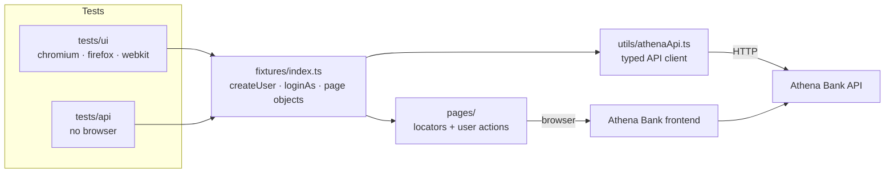
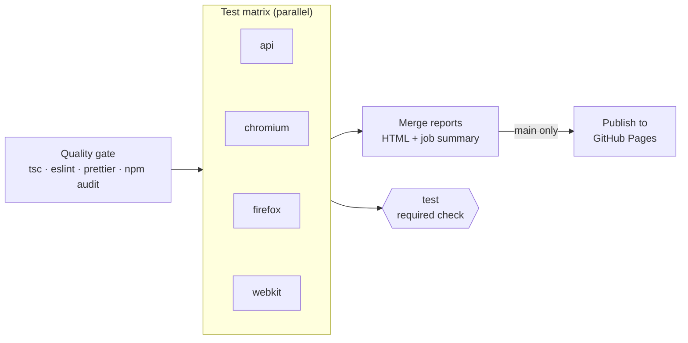

# Athena Bank: E2E & API test automation (Playwright + TypeScript)

[](https://github.com/Zetyre/athena-bank-playwright-tests/actions/workflows/playwright.yml)
[](https://zetyre.github.io/athena-bank-playwright-tests/)


[](LICENSE)

UI and API test automation for **Athena Bank**, a demo banking app (React + Vite frontend, Node/Express backend,
MongoDB). The suite covers sign-up, login, sessions, accounts and money transfers, at the API layer and
end-to-end in Chromium, Firefox and WebKit, plus automated WCAG 2.2 AA accessibility checks.

- **51 test cases, 67 tests** (22 API + 45 UI × 3 browsers = 157 executions), tagged `@smoke` / `@regression`
- **Accessibility audit:** axe-core (WCAG 2.2 AA) scans of the login, sign-up and dashboard pages and the main
  dialogs, contrast measured on the rendered pixels, keyboard access, autofill purpose, page language and titles
- **Fully parallel, no retries locally:** every test creates its own users through the API
- **Found nine real defects** in the app: two that create or lose money, and seven accessibility failures,
  each reported with steps to reproduce and annotated screenshots
  ([known app defects](#known-app-defects))
- **Every run on `main` is published:** [browse the report archive](https://zetyre.github.io/athena-bank-playwright-tests/)

## Why this project

This started as a Playwright workshop exercise, and I rebuilt it as the kind of framework I'd want a team to adopt.
The goal was a suite whose result you can trust:

- **No false failures.** Tests share no state, so a red run means a real problem, not a collision between tests
  or browsers. The suite runs fully parallel with no retries locally.
- **No false passes.** Lint rules block missing `await`s and fixed waits, tests assert outcomes instead of "page
  loaded", and a single required check blocks merging when any browser fails.
- **Failures that explain themselves.** Every failure keeps a trace, a screenshot and a job summary, and every
  run on `main` lands in a public report archive.
- **Testing that finds bugs, not just checks screens.** API-level negative and concurrency tests found two
  money-handling defects in the app, reported as issues with steps to reproduce, screenshots and root cause, and
  the accessibility audit found seven more.

## At a glance

| CI pipeline: quality gate, one job per browser, merged report, required `test` gate                                                   |
| ------------------------------------------------------------------------------------------------------------------------------------- |
|  |

| HTML report: every test tagged and traceable                                                                           | Report archive on GitHub Pages                                                                         |
| ---------------------------------------------------------------------------------------------------------------------- | ------------------------------------------------------------------------------------------------------ |
|  |  |

## Run it locally

**Prerequisites:** Node.js 22 (see `.nvmrc`), Git, and MongoDB 7, either installed locally or in Docker.

### 1. Start the app under test

The [Athena Bank app](https://github.com/Zetyre/redux-athena-bank) lives in its own repository. CI tests it at a
pinned commit, so use the same one:

```bash
git clone https://github.com/Zetyre/redux-athena-bank.git
cd redux-athena-bank
git checkout ecab87e1aee435fd090a8e05b281c89331e275d0
```

Start MongoDB, unless you already have one running:

```bash
docker run -d --name athena-mongo -p 27017:27017 mongo:7.0.3
```

Create `backend/.env`:

```env
MONGO_URI=mongodb://localhost:27017/athena_bank
JWT_SECRET=any-local-secret
PORT=6007
```

Then start the backend and the frontend, each in its own terminal:

```bash
npm ci --prefix backend && npm --prefix backend start      # API on http://localhost:6007
```

```bash
npm ci --prefix frontend && npm --prefix frontend run build
cd frontend && npx vite preview --port 3000 --strictPort  # UI on http://localhost:3000
```

This serves a production build, the same way CI does. The dev server (`npm run dev`) also works for a quick look,
but it serves hundreds of separate modules to each browser, and under the full parallel suite Windows can run out of
socket buffers (`net::ERR_NO_BUFFER_SPACE`), leaving a test with a blank page.

### 2. Install and run the tests

```bash
git clone https://github.com/Zetyre/athena-bank-playwright-tests.git
cd athena-bank-playwright-tests
npm ci
npx playwright install --with-deps
```

| Command                   | What it runs                                                    |
| ------------------------- | --------------------------------------------------------------- |
| `npm test`                | Everything: `api`, `chromium`, `firefox`, `webkit`              |
| `npm run test:smoke`      | Only tests tagged `@smoke`                                      |
| `npm run test:regression` | Only tests tagged `@regression`                                 |
| `npm run test:api`        | The API project, no browser                                     |
| `npm run test:chromium`   | API plus Chromium, the fastest full check                       |
| `npm run report`          | Opens the last HTML report                                      |
| `npm run check`           | Type-check, lint and format check, the same gate CI starts with |

No users need to exist beforehand. Each test creates the users and accounts it needs.

### Configuration

All settings have local defaults, so nothing needs to be set to run the suite against the app on `localhost`.

| Variable               | Default                 | Purpose                                                                              |
| ---------------------- | ----------------------- | ------------------------------------------------------------------------------------ |
| `PLAYWRIGHT_BASE_URL`  | `http://localhost:3000` | Frontend under test                                                                  |
| `API_BASE_URL`         | `http://localhost:6007` | Backend API under test                                                               |
| `PLAYWRIGHT_TEST_SEED` | random per run          | Reproduces the random transfer amounts of a run; recorded in each test's annotations |
| `CI`                   | unset                   | Set by CI: enables `forbidOnly`, one retry and the CI reporters                      |

The suite needs no credentials or secrets: test users are created on the fly with throwaway data.

## Architecture

Tests only talk to fixtures. Fixtures build page objects, create data through the API client and authenticate
browsers, so no test repeats setup code or knows how the app stores its session.



## Project structure

```
.
├── docs/defects/                # Annotated screenshots attached to the defect reports
├── fixtures/index.ts            # Custom test fixtures: page objects, API client, createUser, loginAs, ...
├── pages/                       # Page objects: locators and user actions, no business assertions
├── reporters/known-defects.ts   # Lists open known defects and fails a run when one fails for the wrong reason
├── tests/
│   ├── api/                     # "api" project: contract and negative tests against the backend
│   └── ui/                      # chromium / firefox / webkit projects: end-to-end flows and accessibility
├── types/api.ts                 # Typed request/response models
├── utils/
│   ├── accessibility.ts         # axe-core scan and on-screen contrast measurement
│   ├── athenaApi.ts             # Thin API client returning raw responses
│   ├── knownBug.ts              # knownBug(): issue, summary and expected failure of a known-bug test
│   ├── userFactory.ts           # Unique test users
│   ├── testRandom.ts            # Seeded random numbers
│   └── urls.ts                  # Frontend/API base URLs from the environment
├── scripts/
│   ├── ci-summary.mjs           # Writes the GitHub Actions job summary
│   └── build-report-index.mjs   # Builds the GitHub Pages report archive
├── docs/images/                 # Screenshots used in this README
└── .github/                     # CI workflow, Dependabot, PR template, CODEOWNERS
```

### Tooling built for this project

| Tool                                                               | What it does                                                                                                       |
| ------------------------------------------------------------------ | ------------------------------------------------------------------------------------------------------------------ |
| [`fixtures/index.ts`](fixtures/index.ts)                           | `createUser`, `loginAs`, `openDashboardInNewContext` and `randomAmount`: setup in one line per test                |
| [`utils/athenaApi.ts`](utils/athenaApi.ts)                         | Typed client for the backend, returning raw responses so tests can assert on errors                                |
| [`utils/testRandom.ts`](utils/testRandom.ts)                       | Seeded random numbers, so a "random" failure can be replayed exactly                                               |
| [`utils/accessibility.ts`](utils/accessibility.ts)                 | Runs axe-core after animations settle, and measures text contrast against the pixels actually rendered behind it   |
| [`reporters/known-defects.ts`](reporters/known-defects.ts)         | Lists known defects still present by issue, and fails the run when a known-bug test fails for an undeclared reason |
| [`scripts/ci-summary.mjs`](scripts/ci-summary.mjs)                 | Turns the JSON report into the GitHub Actions job summary (passed, known defects, failed, flaky)                   |
| [`scripts/build-report-index.mjs`](scripts/build-report-index.mjs) | Builds the GitHub Pages report archive and prunes old reports                                                      |

## What a test looks like

An end-to-end test reads as the business scenario. Users, accounts and sessions come from fixtures, and each
step asserts a visible outcome for both sides of the transfer:

```ts
test(
  'TC-014: A transfer made through the UI appears for both sender and receiver',
  { tag: '@smoke' },
  async ({ page, loginAs, createUser, randomAmount, sendMoneyModal, openDashboardInNewContext }) => {
    const sender = await createUser(); // fresh user with a funded account, created through the API
    const receiver = await createUser();
    const amount = randomAmount(1, 1000); // reproducible with PLAYWRIGHT_TEST_SEED
    const senderDashboard = await loginAs(sender);

    await test.step(`Send ${amount} to the receiver through the UI`, async () => {
      await senderDashboard.sendMoneyButton.click();
      await sendMoneyModal.send(receiver.email, amount);
      await expect(page.getByText(`Transferencia enviada a ${receiver.email}`)).toBeVisible();
    });

    await test.step('Verify the incoming transfer in the receiver dashboard', async () => {
      const receiverDashboard = await openDashboardInNewContext(receiver); // second user, second browser context
      const incoming = receiverDashboard.transaction(`Transferencia de ${sender.email}`);
      await expect(incoming).toHaveCount(1);
      await expect(receiverDashboard.transactionAmount(incoming)).toContainText(amount.toFixed(2));
    });
  },
);
```

API tests check the contract and that nothing moves when a request is rejected:

```ts
test(
  'TC-030: A transfer larger than the balance is rejected and nothing moves',
  { tag: '@regression' },
  async ({ api, createUser }) => {
    const sender = await createUser({ initialBalance: 50 });
    const receiver = await createUser({ initialBalance: 0 });

    const response = await api.transfer(sender.token, {
      fromAccountId: sender.account!._id,
      toEmail: receiver.email,
      amount: 51,
    });

    await expectError(response, 400, 'Insufficient funds');
    expect(await balanceOf(api, sender)).toBe(50);
    expect(await balanceOf(api, receiver)).toBe(0);
  },
);
```

The full versions are in [`tests/ui/transactions.spec.ts`](tests/ui/transactions.spec.ts) and
[`tests/api/transfers.api.spec.ts`](tests/api/transfers.api.spec.ts).

## Design decisions

**Test data is created through the API, per test.** The `createUser` fixture signs a user up and opens a funded
account through the backend in a few milliseconds. Nothing is shared between tests, browsers or workers, so the
suite runs fully parallel, any test can run alone, and balance assertions cannot race.

**Authentication skips the login form.** Only the login tests use the form. Everything else uses `loginAs(user)`,
which injects the user's JWT before the app boots (the app keeps it in `localStorage`). This is faster and keeps
login bugs from failing unrelated tests.

**API and UI are separate projects.** API tests don't start a browser. UI tests check what only the UI can show
(navigation, validation messages, what each user sees) and use the API for setup.

**Web-first assertions only.** No `networkidle` and no fixed waits; both are blocked by lint rules.
`DashboardPage.goto()` waits for the dashboard's own data requests and asserts they succeeded, because the app
loads accounts and transactions only once, on mount.

**Accessibility is audited in layers, because one tool is not enough.** axe-core scans each screen and dialog
against WCAG 2.2 A and AA rules, after animations finish (a scan taken while a MUI dialog fades in reports false
contrast failures). But this app draws an animated particle canvas behind everything, and axe cannot see canvas
pixels: it lists almost every text as "needs review" and, for one link, measured it against the wrong background.
So contrast has its own check, `measureTextContrast`. It screenshots an element with its text shown and with its
text made transparent, and compares the text colour with what is really painted behind it, strip by strip, so a
gradient that turns light under white text is caught. A control test (TC-046) proves readable text passes it.
Keyboard access, page language and page titles are checked directly, since no automated rule covers them fully.
Each known defect is asserted in `test.fail()` tests, one per checked text, notification or form, so each fails
for its stated reason today and fails loudly on its own once that part of the defect is fixed.

**A known bug must fail for the right reason.** Playwright counts a `test.fail()` test that fails as passed, so
a known-bug test broken by an unrelated selector or timeout would look fine, and the summary would hide how many
defects are still open. Every known-bug test therefore declares its expected failure with `knownBug()`, for
example the start of the text and "has a contrast ratio of", and the
[known-defects reporter](reporters/known-defects.ts) fails the run when a test fails with any other error. It
also lists the open defects by issue in the terminal and in the job summary, apart from real passes.

**Retries are a signal, not a fix.** There are no retries locally and one on CI, so a flaky test is reported as
"flaky" in the job summary instead of silently passing.

**Tooling.** `typescript-eslint` with type-aware rules (`no-floating-promises` catches a missing `await` on a
Playwright call), `eslint-plugin-playwright`, and Prettier. TypeScript is pinned to 6.0 because
`typescript-eslint` does not support TypeScript 7 yet.

## Test coverage

| Area            | UI                                                                                                                                                                                                                                                                 | API                                                                                                                                                                                                             |
| --------------- | ------------------------------------------------------------------------------------------------------------------------------------------------------------------------------------------------------------------------------------------------------------------ | --------------------------------------------------------------------------------------------------------------------------------------------------------------------------------------------------------------- |
| Sign-up         | Form fields and enabled state, success, duplicate email, request/response contract, mocked 500 (TC-001 to TC-008, TC-010)                                                                                                                                          | Success contract, duplicate email (409), each missing field (400) (TC-009, TC-020, TC-021)                                                                                                                      |
| Login & session | Valid login, wrong password, login response contract, route guard, logout (TC-007, TC-011, TC-015 to TC-017)                                                                                                                                                       | Valid login, wrong password and unknown email (same 401), missing password (TC-022 to TC-025)                                                                                                                   |
| Accounts        | Open an account from the dashboard (TC-019)                                                                                                                                                                                                                        | Created account and balance, missing or invalid token (TC-026 to TC-028)                                                                                                                                        |
| Transfers       | Recipient without an account, client-side balance check, API transfer seen by receiver, UI transfer seen by both users (TC-012 to TC-014, TC-018)                                                                                                                  | Exact debit/credit, insufficient funds with no money moved, zero/negative amounts, unknown recipient, recipient without an account, spending someone else's account, no token, self-transfer (TC-029 to TC-036) |
| Accessibility   | axe-core WCAG 2.2 AA scans of the three pages and the create-account and send-money dialogs, keyboard-only login, keyboard access to "Agregar cuenta", on-screen contrast of text and notifications, autofill purpose, page language and titles (TC-037 to TC-051) | (UI only)                                                                                                                                                                                                       |

## Known app defects

Each defect has a `@known-bug` test that asserts the correct behaviour and is marked `test.fail()`, and each is
reported on the app's repository with steps to reproduce, expected and actual results, root cause and annotated
screenshots. The screenshots are in [`docs/defects/`](docs/defects/).

| Defect                                                                                                                                                                                                                                                                                                                                              | Found by                                                                                                                                                                                                  | Report                                                                                                                                 |
| --------------------------------------------------------------------------------------------------------------------------------------------------------------------------------------------------------------------------------------------------------------------------------------------------------------------------------------------------- | --------------------------------------------------------------------------------------------------------------------------------------------------------------------------------------------------------- | -------------------------------------------------------------------------------------------------------------------------------------- |
| **A transfer to your own account increases the balance.** `routes/transactions.js` loads the same account twice (as sender and recipient) and saves both copies, so sending 100 to yourself turns 1,000 into 1,100.                                                                                                                                 | TC-036 `@known-bug`. It asserts the correct behaviour and is marked `test.fail()`, so it reports "expected to fail" today and will fail loudly once the bug is fixed, as a reminder to remove the marker. | [redux-athena-bank#1](https://github.com/Zetyre/redux-athena-bank/issues/1) · [screenshots](docs/defects/01-self-transfer-after.png)   |
| **Concurrent transfers all succeed, but only one updates the balances.** Five simultaneous transfers of 1,000 from a 1,000 balance all return `200` and all create transaction records (5,000 in the history), while the balances move only 1,000. The balance check and the update are not atomic.                                                 | An ad-hoc concurrency probe while investigating the first defect, reproduced 3 out of 3 times. Not yet automated in the suite.                                                                            | [redux-athena-bank#2](https://github.com/Zetyre/redux-athena-bank/issues/2) · [screenshots](docs/defects/02-concurrent-sender.png)     |
| **The sign-up page's "¿Ya tienes cuenta? Iniciar sesión" prompt is invisible.** It sits outside the form card, beneath the fixed particle canvas, so it is never painted; the link still takes focus and clicks, unseen. It also makes the page 30px wider than a 320px screen. WCAG 1.4.3, 2.4.7, 1.4.10.                                          | TC-043. axe flagged the link with a 4.09:1 ratio against white, which is the wrong background; checking the rendered pixels showed the text is not drawn at all.                                          | [redux-athena-bank#3](https://github.com/Zetyre/redux-athena-bank/issues/3) · [screenshots](docs/defects/03-signup-prompt-missing.png) |
| **Several texts fail contrast.** White text over the cyan end of the blue-to-cyan buttons (about 2.4:1 on login and sign-up, 1.7:1 on "Agregar fondos"), the focused field label in MUI default blue (3.7:1), the account card's type and balance on teal (1.7:1 and 3.5:1), and green and red transaction rows (3.5:1). WCAG 1.4.3 requires 4.5:1. | TC-044 and TC-045, measured on screen in all three browsers.                                                                                                                                              | [redux-athena-bank#4](https://github.com/Zetyre/redux-athena-bank/issues/4) · [screenshots](docs/defects/04-contrast-dashboard.png)    |
| **"Agregar cuenta" cannot be used with a keyboard.** The tile is a `<div>` with a click handler and no `tabindex` or role, so Tab skips it and screen readers do not announce it as a control. WCAG 2.1.1, 4.1.2.                                                                                                                                   | TC-047                                                                                                                                                                                                    | [redux-athena-bank#5](https://github.com/Zetyre/redux-athena-bank/issues/5) · [screenshots](docs/defects/05-keyboard-tab-order.png)    |
| **The page language is English, but the interface is Spanish.** `index.html` keeps `<html lang="en">`, so screen readers use English pronunciation. WCAG 3.1.1.                                                                                                                                                                                     | TC-048                                                                                                                                                                                                    | [redux-athena-bank#6](https://github.com/Zetyre/redux-athena-bank/issues/6) · [screenshots](docs/defects/06-07-titles-and-lang.png)    |
| **Every page is titled "Vite + React + TS".** The Vite template title was never replaced, so tabs, history and screen readers cannot tell pages apart. WCAG 2.4.2.                                                                                                                                                                                  | TC-049                                                                                                                                                                                                    | [redux-athena-bank#7](https://github.com/Zetyre/redux-athena-bank/issues/7) · [screenshots](docs/defects/06-07-titles-and-lang.png)    |
| **Success and info notifications fail contrast.** Toasts keep the notistack default colours: white on green `#43a047` (3.3:1) after creating an account or sending money, and white on blue `#2196f3` (3.1:1) after freezing an account. WCAG 1.4.3 requires 4.5:1.                                                                                 | TC-050, measured on screen in all three browsers; axe-core reports the same ratios.                                                                                                                       | [redux-athena-bank#8](https://github.com/Zetyre/redux-athena-bank/issues/8) · [screenshots](docs/defects/08-toast-success.png)         |
| **Login and sign-up fields do not identify their purpose.** No input sets `autocomplete`, and the sign-up form sets `autocomplete="off"`, so browsers cannot offer to fill in the user's own name, email or password. WCAG 1.3.5.                                                                                                                   | TC-051                                                                                                                                                                                                    | [redux-athena-bank#9](https://github.com/Zetyre/redux-athena-bank/issues/9) · [screenshots](docs/defects/09-autocomplete-signup.png)   |

## CI pipeline

[`.github/workflows/playwright.yml`](.github/workflows/playwright.yml)

| Trigger                | What runs                                                              |
| ---------------------- | ---------------------------------------------------------------------- |
| Pull request to `main` | Full suite on `api` and `chromium`, `@smoke` on `firefox` and `webkit` |
| Push to `main`         | Full suite on every project, then publishes the report                 |
| Nightly (03:00 UTC)    | Full suite on every project, then publishes the report                 |
| Manual                 | Full suite or `@smoke`, chosen when starting the run                   |



1. **Quality gate:** type-check, lint, format check and `npm audit` run before any browser starts.
2. **Test matrix:** one job per project, in parallel, inside the official Playwright image. The image tag is read
   from the lockfile, so a Dependabot bump of `@playwright/test` cannot leave the browsers out of sync. Each job
   starts MongoDB, the backend and a **production build** of the frontend (`vite preview`), with the app pinned
   to a specific commit.
3. **Report:** blob reports from all jobs are merged into one HTML report. A job summary lists passed tests, known
   defects still present (by issue), failed and flaky tests. The full report, with traces and screenshots, is kept as a workflow artifact for 7 days.
4. **Gate:** a single `test` job is the required status check for `main`. It fails unless the quality gate and
   every matrix job succeeded, so branch protection never needs editing when the matrix changes.
5. **Publish:** on `main`, every run's report (passed or failed) goes to the
   [GitHub Pages archive](https://zetyre.github.io/athena-bank-playwright-tests/) with its status and a link to the
   run. The last 30 are kept.

**Security.** Actions are pinned to commit SHAs, `GITHUB_TOKEN` is read-only except in the publish job, and
checkouts don't keep credentials. Test users exist only in an ephemeral CI database. Even so, the public Pages
copy strips traces and screenshots; they stay in the short-lived artifact.

### Reading a failure

1. Open the run's **Summary** to see which tests failed or were flaky.
2. Download the `playwright-report` artifact, unzip it and run `npx playwright show-report <folder>`.
3. Open the failed test and its **Trace** to step through actions, network calls and DOM snapshots.

## Known limitations

- The app hardcodes `http://localhost:6007` for login and sign-up (`Login.tsx`, `SignUp.tsx`) and only allows CORS
  from port 3000, so the UI suite can only target an app served from `localhost:3000`. The API suite can target
  any environment through `API_BASE_URL`.
- Locally, workers are capped at 30% of CPU cores. Above about six concurrent Firefox instances, Firefox's
  software compositor crashes on Windows. CI is not affected, since it runs one browser per job.

## Tech stack

Playwright, TypeScript, axe-core (`@axe-core/playwright`), ESLint (`typescript-eslint`, `eslint-plugin-playwright`),
Prettier, GitHub Actions.

## Contributing and license

Changes go through pull requests (see the [PR checklist](.github/pull_request_template.md)) and are listed in the
[changelog](CHANGELOG.md). Released under the [MIT License](LICENSE).

## Author

**Cristian Marrero**, QA Engineer. [LinkedIn](https://www.linkedin.com/in/cristian-marrero)
