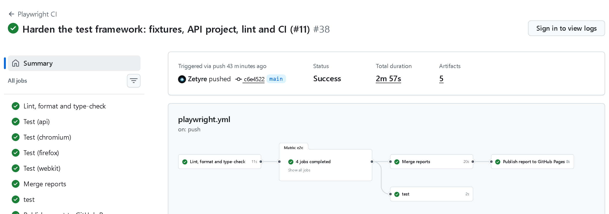
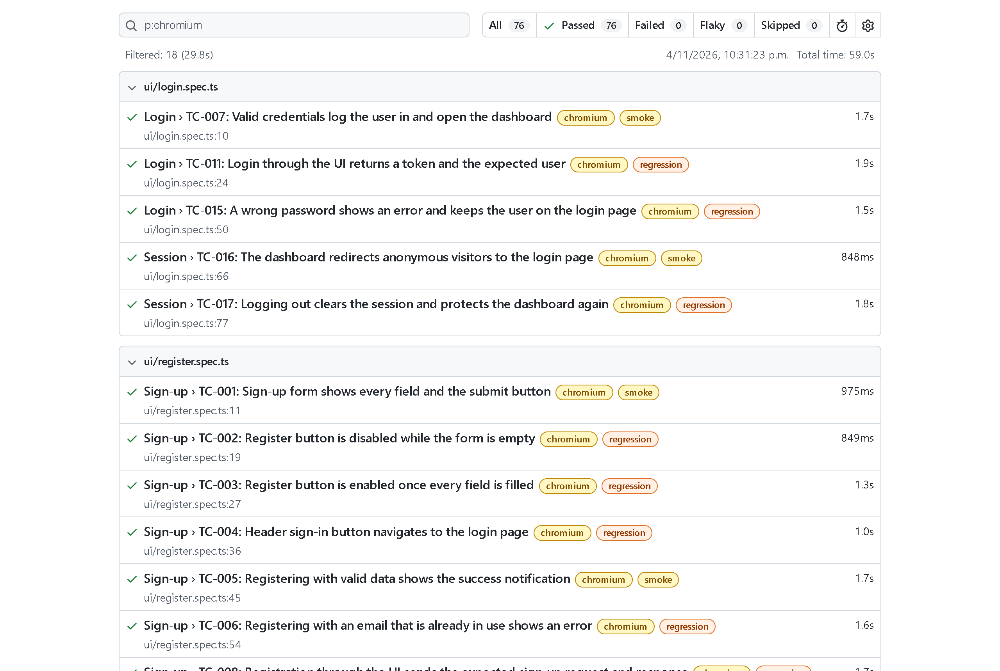
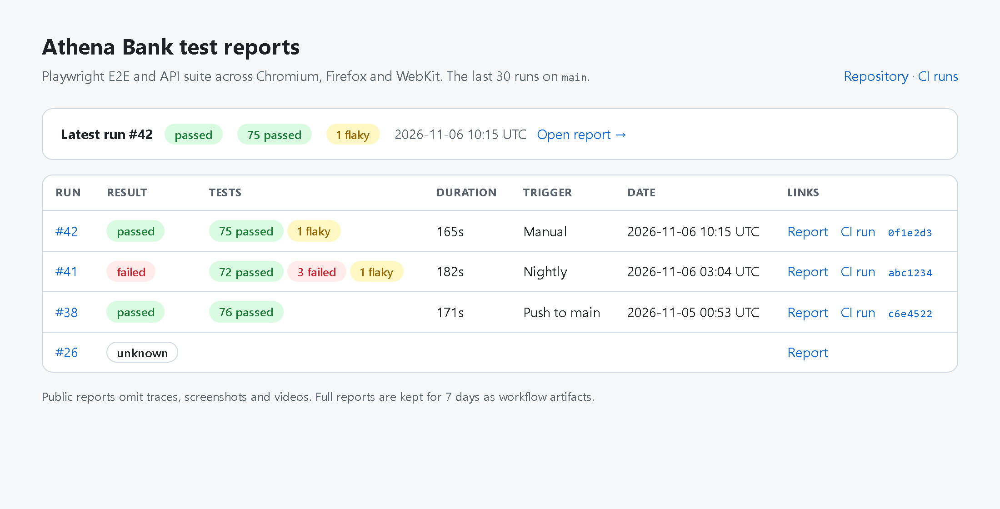
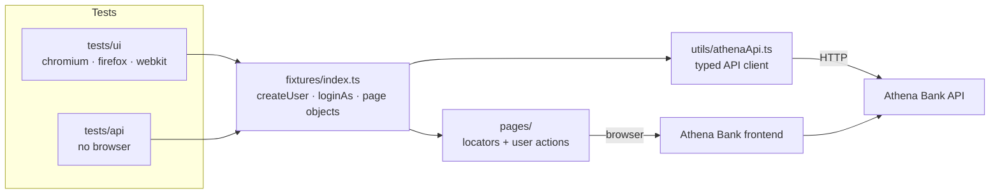
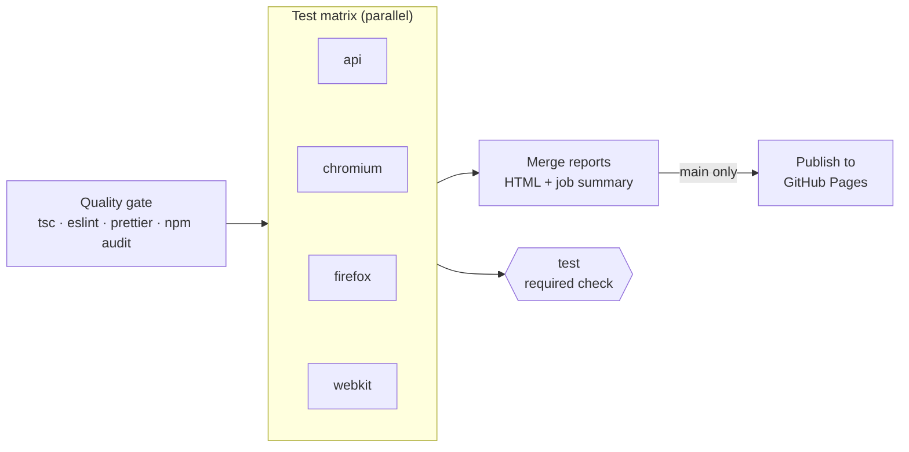

# Athena Bank: E2E & API test automation (Playwright + TypeScript)

[](https://github.com/Zetyre/athena-bank-playwright-tests/actions/workflows/playwright.yml)
[](https://zetyre.github.io/athena-bank-playwright-tests/)


[](LICENSE)

UI and API test automation for **Athena Bank**, a demo banking app (React + Vite frontend, Node/Express backend,
MongoDB). The suite covers sign-up, login, sessions, accounts and money transfers, at the API layer and
end-to-end in Chromium, Firefox and WebKit.

- **36 test cases, 40 tests** (22 API + 18 UI × 3 browsers = 76 executions), tagged `@smoke` / `@regression`
- **Fully parallel, no retries locally:** every test creates its own users through the API
- **Found a real defect** in the app: a transfer to your own account creates money ([TC-036](#known-app-defects))
- **Every run on `main` is published:** [browse the report archive](https://zetyre.github.io/athena-bank-playwright-tests/)

## At a glance

| CI pipeline: quality gate, one job per browser, merged report, required `test` gate                                                   |
| ------------------------------------------------------------------------------------------------------------------------------------- |
|  |

| HTML report: every test tagged and traceable                                                                           | Report archive on GitHub Pages                                                                         |
| ---------------------------------------------------------------------------------------------------------------------- | ------------------------------------------------------------------------------------------------------ |
|  |  |

## Quick start

Prerequisites: Node.js 22 (`.nvmrc`) and the [Athena Bank app](https://github.com/Zetyre/redux-athena-bank)
running locally, with the frontend on `http://localhost:3000`, the API on `http://localhost:6007` and MongoDB
available to the backend.

```bash
npm ci
npx playwright install --with-deps
npm test               # all projects: api, chromium, firefox, webkit
npm run test:smoke     # @smoke only
npm run test:api       # API project only, no browser
npm run report         # open the last HTML report
npm run check          # type-check + lint + format check (what CI runs first)
```

No users need to exist beforehand. Each test creates the users and accounts it needs.

URLs can be overridden with `PLAYWRIGHT_BASE_URL` and `API_BASE_URL`. Set `PLAYWRIGHT_TEST_SEED` to reproduce
the random transfer amounts of a given run; the seed is recorded in each test's annotations.

## Architecture

Tests only talk to fixtures. Fixtures build page objects, create data through the API client and authenticate
browsers, so no test repeats setup code or knows how the app stores its session.



## Project structure

```
.
├── fixtures/index.ts            # Custom test fixtures: page objects, API client, createUser, loginAs, ...
├── pages/                       # Page objects: locators and user actions, no business assertions
├── tests/
│   ├── api/                     # "api" project: contract and negative tests against the backend
│   └── ui/                      # chromium / firefox / webkit projects: end-to-end flows
├── types/api.ts                 # Typed request/response models
├── utils/
│   ├── athenaApi.ts             # Thin API client returning raw responses
│   ├── userFactory.ts           # Unique test users
│   ├── testRandom.ts            # Seeded random numbers
│   └── urls.ts                  # Frontend/API base URLs from the environment
├── scripts/
│   ├── ci-summary.mjs           # Writes the GitHub Actions job summary
│   └── build-report-index.mjs   # Builds the GitHub Pages report archive
├── docs/images/                 # Screenshots used in this README
└── .github/                     # CI workflow, Dependabot, PR template, CODEOWNERS
```

## Design decisions

**Test data is created through the API, per test.** The `createUser` fixture signs a user up and opens a funded
account through the backend in a few milliseconds. Nothing is shared between tests, browsers or workers, so the
suite runs fully parallel, any test can run alone, and balance assertions cannot race.

**Authentication skips the login form.** Only the login tests use the form. Everything else uses `loginAs(user)`,
which injects the user's JWT before the app boots (the app keeps it in `localStorage`). This is faster and keeps
login bugs from failing unrelated tests.

**API and UI are separate projects.** API tests don't start a browser. UI tests check what only the UI can show
(navigation, validation messages, what each user sees) and use the API for setup.

**Web-first assertions only.** No `networkidle` and no fixed waits; both are blocked by lint rules.
`DashboardPage.goto()` waits for the dashboard's own data requests and asserts they succeeded, because the app
loads accounts and transactions only once, on mount.

**Retries are a signal, not a fix.** There are no retries locally and one on CI, so a flaky test is reported as
"flaky" in the job summary instead of silently passing.

**Tooling.** `typescript-eslint` with type-aware rules (`no-floating-promises` catches a missing `await` on a
Playwright call), `eslint-plugin-playwright`, and Prettier. TypeScript is pinned to 6.0 because
`typescript-eslint` does not support TypeScript 7 yet.

## Test coverage

| Area            | UI                                                                                                                                                | API                                                                                                                                                                                                             |
| --------------- | ------------------------------------------------------------------------------------------------------------------------------------------------- | --------------------------------------------------------------------------------------------------------------------------------------------------------------------------------------------------------------- |
| Sign-up         | Form fields and enabled state, success, duplicate email, request/response contract, mocked 500 (TC-001 to TC-008, TC-010)                         | Success contract, duplicate email (409), each missing field (400) (TC-009, TC-020, TC-021)                                                                                                                      |
| Login & session | Valid login, wrong password, login response contract, route guard, logout (TC-007, TC-011, TC-015 to TC-017)                                      | Valid login, wrong password and unknown email (same 401), missing password (TC-022 to TC-025)                                                                                                                   |
| Accounts        | Open an account from the dashboard (TC-019)                                                                                                       | Created account and balance, missing or invalid token (TC-026 to TC-028)                                                                                                                                        |
| Transfers       | Recipient without an account, client-side balance check, API transfer seen by receiver, UI transfer seen by both users (TC-012 to TC-014, TC-018) | Exact debit/credit, insufficient funds with no money moved, zero/negative amounts, unknown recipient, recipient without an account, spending someone else's account, no token, self-transfer (TC-029 to TC-036) |

## Known app defects

| Test                | Defect                                                                                                                                                                                                                                                                                                                                                                                                         |
| ------------------- | -------------------------------------------------------------------------------------------------------------------------------------------------------------------------------------------------------------------------------------------------------------------------------------------------------------------------------------------------------------------------------------------------------------- |
| TC-036 `@known-bug` | **A transfer to your own account increases the balance.** `routes/transactions.js` loads the same account twice (as sender and recipient) and saves both copies, so sending 100 to yourself turns 1,000 into 1,100. The test asserts the correct behaviour and is marked `test.fail()`, so it reports "expected to fail" today and will fail loudly once the bug is fixed, as a reminder to remove the marker. |

## CI pipeline

[`.github/workflows/playwright.yml`](.github/workflows/playwright.yml)

| Trigger                | What runs                                                              |
| ---------------------- | ---------------------------------------------------------------------- |
| Pull request to `main` | Full suite on `api` and `chromium`, `@smoke` on `firefox` and `webkit` |
| Push to `main`         | Full suite on every project, then publishes the report                 |
| Nightly (03:00 UTC)    | Full suite on every project, then publishes the report                 |
| Manual                 | Full suite or `@smoke`, chosen when starting the run                   |



1. **Quality gate:** type-check, lint, format check and `npm audit` run before any browser starts.
2. **Test matrix:** one job per project, in parallel, inside the official Playwright image. The image tag is read
   from the lockfile, so a Dependabot bump of `@playwright/test` cannot leave the browsers out of sync. Each job
   starts MongoDB, the backend and a **production build** of the frontend (`vite preview`), with the app pinned
   to a specific commit.
3. **Report:** blob reports from all jobs are merged into one HTML report. A job summary lists passed, failed and
   flaky tests. The full report, with traces and screenshots, is kept as a workflow artifact for 7 days.
4. **Gate:** a single `test` job is the required status check for `main`. It fails unless the quality gate and
   every matrix job succeeded, so branch protection never needs editing when the matrix changes.
5. **Publish:** on `main`, every run's report (passed or failed) goes to the
   [GitHub Pages archive](https://zetyre.github.io/athena-bank-playwright-tests/) with its status and a link to the
   run. The last 30 are kept.

**Security.** Actions are pinned to commit SHAs, `GITHUB_TOKEN` is read-only except in the publish job, and
checkouts don't keep credentials. Test users exist only in an ephemeral CI database. Even so, the public Pages
copy strips traces and screenshots; they stay in the short-lived artifact.

### Reading a failure

1. Open the run's **Summary** to see which tests failed or were flaky.
2. Download the `playwright-report` artifact, unzip it and run `npx playwright show-report <folder>`.
3. Open the failed test and its **Trace** to step through actions, network calls and DOM snapshots.

## Known limitations

- The app hardcodes `http://localhost:6007` for login and sign-up (`Login.tsx`, `SignUp.tsx`) and only allows CORS
  from port 3000, so the UI suite can only target an app served from `localhost:3000`. The API suite can target
  any environment through `API_BASE_URL`.
- Locally, workers are capped at 30% of CPU cores. Above about six concurrent Firefox instances, Firefox's
  software compositor crashes on Windows. CI is not affected, since it runs one browser per job.

## Tech stack

Playwright, TypeScript, ESLint (`typescript-eslint`, `eslint-plugin-playwright`), Prettier, GitHub Actions.

## Contributing and license

Changes go through pull requests (see the [PR checklist](.github/pull_request_template.md)) and are listed in the
[changelog](CHANGELOG.md). Released under the [MIT License](LICENSE).

## Author

**Cristian Marrero**, QA Engineer. [LinkedIn](https://www.linkedin.com/in/cristian-marrero)
